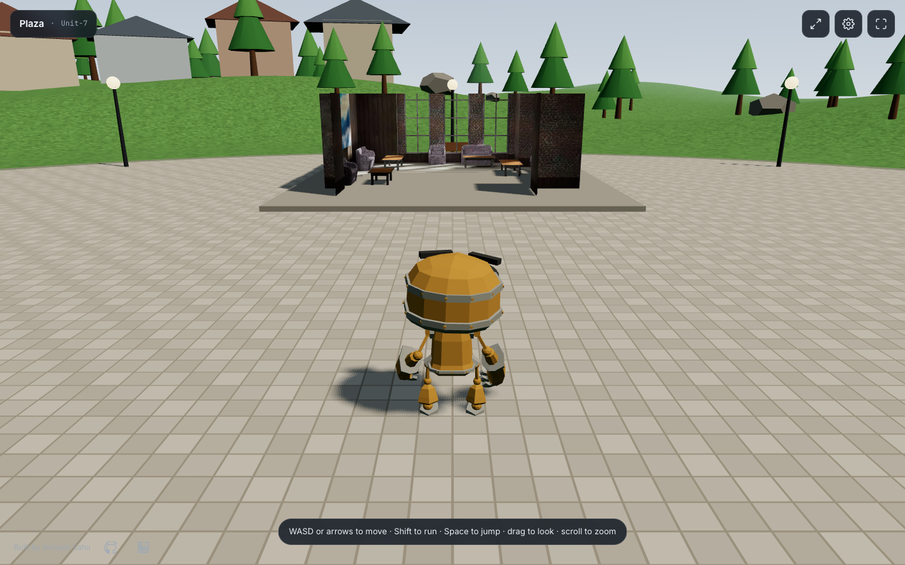

# 3D Virtual Environment

A walkable three.js world: pick an avatar, then explore a plaza in third person with
WASD or a touch joystick. Compressed glTF assets, soft shadows, a settings panel and a
mobile layout that works at 390 px.

**Live demo:** https://avinash9694.github.io/3D-Virtual-Environment/



Deep-link straight into the world with `?avatar=robot`, `?avatar=soldier` or `?avatar=xbot`.

## Why I built this

This started as a three.js tutorial repo that loaded a 35 MB Sketchfab room and let you
orbit around it. I rebuilt it into a complete, stable experience to practise the things a
real-time web app needs that a CRUD app does not: an asset pipeline with hard size
budgets, a fixed-cost render loop with no per-frame allocations, input that works
identically for keyboard, mouse and touch, and settings that degrade gracefully on weak
GPUs. The same discipline (progress states, persisted preferences wrapped in try/catch,
pure logic kept out of the DOM so it can be unit-tested) is what I apply to my day-to-day
desktop and web work.

## Features

- **Avatar picker** with a live rotating preview, name, description and keyboard
  (arrow-key) navigation. Three MIT-licensed characters from the three.js examples:
  Unit-7 (RobotExpressive), Ranger (Soldier) and X-Bot.
- **Locomotion state machine**: idle, walk, run and jump driven through an
  `AnimationMixer` with cross-fades. Walk and run cycles are time-scaled by the actual
  speed so feet do not slide when the stick is half pushed.
- **Third-person controller**: camera-relative WASD/arrows, Shift to run, Space to jump
  with simple gravity, smooth turn toward the movement direction, ground clamp via a
  downward raycast, circular obstacle push-out for props and an invisible world boundary.
- **Camera rig**: drag to orbit, scroll or pinch to zoom, frame-rate independent soft
  spring follow, ground avoidance. No pointer lock, so it works embedded in an iframe.
- **Touch controls**: virtual joystick (left), look pad (right), run toggle and jump
  button, all via pointer events. Shown automatically on coarse-pointer devices.
- **Procedural environment**: gradient sky dome shader, matched fog, rolling terrain
  around a paved plaza, 140 instanced trees, boulders, lamp posts, benches, a fountain and
  three clusters of low-poly houses, all seeded so the world is identical every visit.
- **The original room as a landmark**: the Sketchfab sitting room, compressed from
  34.85 MB to 486 KB, sits on a plinth as a doll's-house cutaway (two clipping planes
  remove the ceiling and front wall) that you can walk straight into.
- **Rendering polish**: ACES tone mapping, sRGB output, shadow camera that follows the
  player, pixel ratio capped at 2, resize handling, and the loop pauses when the tab is
  hidden.
- **Loading screen** with real byte-level progress aggregated across concurrent
  downloads, plus an error state with retry.
- **Settings panel**: quality (pixel ratio cap and shadow map size), shadows on/off,
  interface theme (system / dark / light). Persisted to `localStorage` behind try/catch.
- **Accessibility**: semantic landmarks, labelled controls, focus trap in the dialog,
  `aria-live` loading status, visible focus rings, `prefers-reduced-motion` respected.
- **WebGL-unsupported message** instead of a blank page.

## Controls

| Action        | Desktop                       | Touch                  |
| ------------- | ----------------------------- | ---------------------- |
| Move          | `W A S D` or arrow keys       | Left joystick          |
| Run           | hold `Shift`                  | Run toggle button      |
| Jump          | `Space`                       | Jump button            |
| Look / orbit  | drag with the mouse           | drag on the right half |
| Zoom          | scroll wheel                  | pinch                  |
| Change avatar | HUD button (top right)        | HUD button (top right) |
| Settings      | HUD gear button, `Esc` closes | HUD gear button        |

## Asset pipeline

Everything in `public/models/` went through `@gltf-transform/cli optimize` with meshopt
compression, WebP textures capped at 1024 px, dedupe, weld and prune. The script that
reproduces it is `scripts/optimize-assets.mjs`.

| Asset                                | Before   | After  |
| ------------------------------------ | -------- | ------ |
| `scene.glb` (Sketchfab sitting room) | 34.85 MB | 486 KB |
| `avatars/RobotExpressive.glb`        | 464 KB   | 183 KB |
| `avatars/Soldier.glb`                | 2.16 MB  | 557 KB |
| `avatars/Xbot.glb`                   | 2.93 MB  | 611 KB |
| **Total shipped**                    | 40.4 MB  | 1.8 MB |

The room's 4096² PNG metal-roughness map alone was 22.7 MB. Because the room's lighting
is baked into its colour map, it is rendered with an unlit material at runtime. The
original `src/static/scene1.gltf` was removed from the working tree in favour of the
compressed `scene.glb`; it remains in git history. Decoding uses three's bundled
`MeshoptDecoder`, so no extra decoder files need to be served.

## Architecture

```
src/
├─ main.ts            WebGL check, boots the app
├─ app.ts             Orchestrates loading → avatar select → world, owns the frame loop
├─ engine/            renderer setup, rAF loop (pauses when hidden), asset loader with
│                     byte-level progress, math helpers
├─ world/             sky shader, terrain + height function, procedural props,
│                     landmark cutaway, lights, bounds/obstacles, preview stage
├─ avatar/            avatar catalog, model normalisation, AnimationMixer wrapper,
│                     pure locomotion state machine
├─ controls/          pure input→direction math, keyboard, pointer orbit, joystick
│                     math, camera spring, character controller, camera rig
└─ ui/                vanilla DOM screens: loading, avatar select, HUD, touch controls,
                      settings dialog, settings store, theme, footer
```

Design rules that shaped it:

- **Pure logic is separate from three.js and the DOM.** Movement vectors, the animation
  state machine, camera spring math, joystick mapping, bounds, progress aggregation and
  settings persistence are plain functions, which is what the unit tests cover.
- **Zero allocations in the frame loop.** Input, orbit deltas, raycast hit lists and
  scratch vectors are created once and written into.
- **Frame-rate independence.** Every smoothing uses `exp(-lambda * dt)`, and `dt` is
  capped so a long tab switch cannot teleport the player.
- **Every async path has a state.** The loading screen shows progress, completion and
  failure with retry; settings fall back to defaults when storage is unavailable.

## Tech stack

Vite 7 · TypeScript (strict) · three.js r186 · Vitest · ESLint (flat config,
typescript-eslint) · Prettier · GitHub Actions → GitHub Pages

## Running locally

```bash
npm ci
npm run dev        # http://localhost:5173/3D-Virtual-Environment/
npm run build      # production build into dist/
npm run preview    # serve the build
```

To regenerate the compressed models from raw sources (not in the repo):

```bash
npm run assets:optimize -- /path/to/raw   # expects scene1.gltf and avatars/*.glb
```

## Testing

```bash
npm run typecheck
npm run lint
npm test -- --run
```

59 Vitest unit tests cover the input→movement math, the locomotion state machine and
clip resolution, camera orbit/spring math, joystick dead-zone mapping, world bounds and
obstacle resolution, progress aggregation, and settings sanitising/persistence including
throwing storage.

## Project structure

```
.github/workflows/deploy.yml   lint → typecheck → test → build → Pages
public/models/                 compressed .glb assets (scene + avatars)
scripts/optimize-assets.mjs    reproducible gltf-transform pipeline
src/                           see Architecture
docs/screenshot.png            README screenshot
```

## Roadmap and known limitations

- Collision is circle-based for props only; the landmark's furniture can be walked
  through.
- No physics engine: slopes are handled by raycast clamping, so very steep terrain would
  feel like stairs. The current terrain is gentle by design.
- Ranger and X-Bot have no authored jump clip, so they hold their current pose while
  airborne.
- Shadows and the 2× pixel ratio are heavy on older phones; the Low quality preset is
  the intended fallback.
- Ideas: multiplayer presence via WebRTC, a day/night cycle, and KTX2 textures once
  GPU compressed texture support is broad enough to justify the decoder.

## Credits

Avatar models (`RobotExpressive`, `Soldier`, `Xbot`) are from the
[three.js examples](https://github.com/mrdoob/three.js/tree/dev/examples/models/gltf),
MIT licensed. The sitting room is the Sketchfab model that shipped with the original
version of this repository.

## License

MIT — see [LICENSE](LICENSE).
